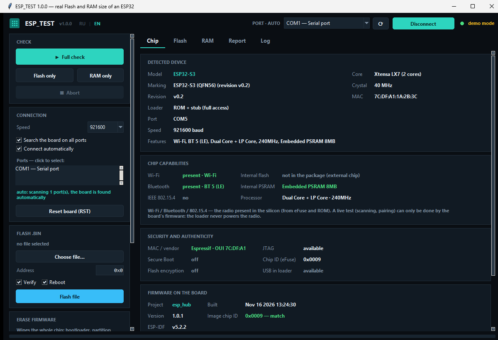

# ESP_TEST

**Documentation language / Язык документации:**
**🇬🇧 English (you are here)** · **[🇷🇺 Русский — README.md](README.md)**

---

A tool that measures the **real** memory size of ESP32 boards (ESP32, S2, S3, C2, C3, C5, C6, H2,
P4, ESP8266): flash and SRAM. It can also flash any `.bin`, fully erase the chip, and run a
destructive full-flash test with an automatic backup.

One single exe, nothing to install: **esptool is bundled inside**, so Arduino IDE, PlatformIO and
ESP-IDF are not required on the machine.

```
dist/ESP_TEST.exe
```

**Version:** 1.0.0  
**Interface:** Russian (default) and English — switch with the `RU | EN` toggle in the window header.



---

## What exactly is checked

### Chip: what hardware this is
| Check | Data source |
|---|---|
| Model, marking, revision | ROM loader (chip ID, eFuse) |
| MAC and Espressif OUI membership | eFuse + OUI table |
| **Wi-Fi / Bluetooth / IEEE 802.15.4** | capability flags from eFuse and ROM |
| Embedded flash / PSRAM in the package | eFuse (pkg_version) |
| CPU core and frequency | eFuse |
| Secure Boot, flash encryption, JTAG, USB | `get_security_info()` — real eFuse flags |
| What firmware is on the board | application descriptor: project, version, ESP-IDF, build date |
| Image/chip match | chip ID in the image header vs. the chip's own chip ID |

**A note on Wi-Fi.** The tool reports **whether the radio exists in the silicon** and whether it is
disabled at the eFuse level. A live test — scanning networks, joining an access point — can only be
done by firmware running on the board: the ROM loader never powers the radio, and no program can do
that "over a COM port".

### Flash (the main part)
| Check | How it is done |
|---|---|
| Real capacity | RDID command (0x9F) sent to the flash chip itself → JEDEC ID → manufacturer and density |
| Cross-check | loader autodetection (SFDP / esptool table) |
| What the image claims | flash size byte in the bootloader header (byte 3) |
| What is actually mapped | partition table parsing, total size and end of the last partition |
| Verdict | "capacity confirmed" / "claims more than it has" (typical on cheap modules) / "claims less" |

### Flashing any .bin
The **FLASH .BIN** block: the **Choose file…** button, an address field
(`0x0` by default) and the "Прошить файл" (Flash file) button.

* works with any image: a merged image at `0x0`, separate `bootloader.bin` / `partitions.bin` /
  `firmware.bin` at their own offsets, LittleFS/SPIFFS images, arbitrary dumps;
* the address may be written as `0x10000`, `65536` or `0`; if it is not sector-aligned (4096) the
  tool rounds it down and pads the gap with `0xFF`, saying so in the log;
* a file that does not fit into flash at the given address is rejected with a clear error;
* **Verify** — after writing, the image is read back and compared byte by byte; the
  first mismatching block is reported;
* **Reboot** — reset the board after writing. Clear it to flash several files in
  a row (bootloader → partitions → app) and then press "Сбросить плату (RST)" once;
* after flashing a full image at `0x0` the flash identity is re-read automatically.

Speed on an ESP32-C3 over native USB is about 360 KB/s: a 2.2 MB image takes roughly 6 s to write
and about as long to verify.

### Erasing flash (complete, irreversible)
**Erase flash completely** wipes the whole chip: bootloader, partition
table, application, NVS, file system and coredump.

* no backup is made — the data is gone for good;
* confirmation must be typed by hand: the word `ERASE` (in the Russian UI — `СТЕРЕТЬ`), the button
  stays disabled until it matches;
* after erasing, the tool reads the beginning of flash back and checks that it really is `0xFF`,
  then resets the board and closes the session;
* if **Secure Boot** or flash encryption is enabled, the loader refuses to erase — the tool reports
  that honestly instead of damaging the board;
* to make the board work again, flash it: the "Flash .bin" block, Arduino IDE or ESP-IDF.

### Deep flash test (optional, destructive)
Writes a pseudo-random pattern over the whole flash, reads it back and compares block by block.

* a **full backup** is taken first (to `Documents` by default);
* afterwards the firmware is **restored automatically** and verified;
* interrupting it (the "Прервать" / Abort button) does not brick the board: the restore still runs;
* if the chip is smaller than the marking suggests, errors start at a certain address — the tool
  shows the first failing block and estimates the real capacity;
* read and write throughput are measured along the way.

⚠️ During the test the firmware and its data (NVS, SPIFFS/LittleFS) are temporarily erased.
Do not unplug the board while it runs.

### RAM
* internal SRAM is a property of the chip model (520 KB on ESP32, 512 KB on S3/C6, 400 KB on C3…);
  it cannot be faked, so the size comes from the Espressif reference table;
* **data bus test**: 68 patterns (0x00, 0xFF, 0x55, 0xAA, walking one and its inverse) are written
  to and read from a free SRAM region below the stub loader;
* **address bus test**: 8 independent cells with different values — catches broken or stuck address
  lines;
* external PSRAM is **not measured** through the ROM loader: it is not initialised before the
  firmware runs, so reading its address space proves nothing. The UI shows the typical capacity for
  the model plus an explanation.

---

## Interface language

The UI is **Russian by default**; click `EN` in the header (next to the version number) to switch
to English, `RU` to switch back. The choice is remembered in
`%APPDATA%\ESP_TEST\settings.json` and applied on the next start. Everything is translated:
tabs, buttons, hints, log lines, the report and the erase confirmation word (`ERASE`).

---

## How to use it

1. Connect the board with a USB cable (a data cable, not a charge-only one).
2. Start `ESP_TEST.exe` — **the board is found and connected automatically**.
3. The port list is polled every 1.5 s: a board plugged in after start appears in the list and is
   selected automatically (USB ports first, the motherboard's COM1 last). The **Connect automatically**
   checkbox turns auto-connect off.
4. **Manual port selection**: every detected port is listed in the **CONNECTION** block.
   Click a row (or pick a port in the header drop-down) — the mode switches to `PORT · MANUAL`,
   autodetection is disabled and the tool works only with that port. If the chosen
   board disappears and comes back, the tool reconnects to exactly that one and never touches other
   boards. To go back, tick **Search the board on all ports**.
5. **Hot swap**: unplug one board, plug in another — the tool notices the port disappearing (or a
   different VID:PID on the same COM), closes the session, finds the new board and connects to it.
   Every ~7 s a silent liveness probe runs, which also catches a board swapped behind the same COM
   number.
6. If there are no ports at all, the **CONNECTION** block states the reason: either "no Espressif /
   USB-UART device in the system" (cable, port, power) or "USB device `VID:PID` is present but no
   COM port was created" (USB-UART driver missing).
7. Tabs: **Чип** (Chip) — model, capabilities, security, firmware; **Flash** — flash identity and
   verdict; **ОЗУ** (RAM) — SRAM test; **Отчёт** (Report) — ready text plus a "Save report" button;
   **Журнал** (Log) — what is happening right now.
8. The **FLASH .BIN** and **ERASE FIRMWARE** blocks flash any image and wipe the chip
   completely (see above).

The **⟳** button forces a port list refresh.

If the automatic download-mode entry fails: hold **BOOT**, press and release **EN/RST**, release
**BOOT**, then press "Подключиться" (Connect). The speed can be lowered to 115200 in the
**CONNECTION** block.

### Demo mode
`ESP_TEST.exe --demo` — the full UI with data from a virtual ESP32-S3 board, no hardware needed
(handy for a quick look at the interface).

---

## Requirements

* Windows 10/11 x64;
* the board's USB-UART driver (CP210x, CH340, FTDI) — the only thing that may need installing;
  boards with native USB (ESP32-S2/S3/C3/C6) need no driver at all;
* the exe itself installs nothing and writes nothing to the registry.

Files the tool creates: flash backups in `Documents` (`esp_flash_backup_<port>_<date>.bin`) and the
reports you save manually.

---

## Building from source

```bat
pip install esptool pyserial pyinstaller pillow
python build.py
```

Result: `dist\ESP_TEST.exe` (~53 MB, everything inside: Python, Tk, esptool with stub loaders for
every chip, pyserial).

Build check without hardware:

```bat
dist\ESP_TEST.exe --selftest
type dist\_selftest.txt
```

### Project layout

| File | Purpose |
|---|---|
| `main.py` | entry point, windowed mode, `--demo`, `--selftest` |
| `gui.py` | Tkinter UI (dark theme, custom buttons, cards, gauges) |
| `probe.py` | hardware layer via esptool: chip, flash, erase, `.bin` flashing, deep test, SRAM |
| `chipdb.py` | reference data: SRAM per model, flash manufacturers, density codes, Espressif OUIs |
| `i18n.py` | RU → EN translation dictionary and language switching (settings in `%APPDATA%`) |
| `version.py` | application name and version in one place |
| `build.py` | single-exe build and icon generation |

---

## Limitations

* The deep test is destructive; if power is lost during the restore step the board must be reflashed
  (the bootloader is erased along with everything else).
* Erasing flash is irreversible: no backup is taken, the firmware has to be flashed again.
* On a board with Secure Boot or flash encryption enabled, erasing is blocked by the chip itself.
* The SRAM test checks cell integrity, not "capacity": capacity is a property of the silicon.
* PSRAM, flash encryption and Secure Boot are not tested — only their flags are read.
* Throughput depends on the USB-UART bridge and the loader mode: at 921600 baud expect 100–150 KB/s
  with an external USB-UART and ~360 KB/s with native USB.
